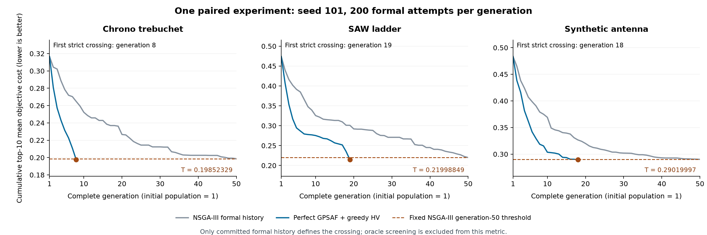

# Greedy-HV 默认 GPSAF 的 perfect-surrogate 六单元比较

六单元正式workflow已完成并通过独立核验。Chrono、SAW、天线首次严格跨越各自NSGA-III第50代阈值的代数分别为8、19、18，正式预算分别减少84%、62%、64%。SAW的完整优化命令耗时反而增加，oracle物理调用必须单独计入；这是一次配对实验。

## 问题与冻结协议

问题是：对于三项物理任务，在 perfect oracle 提供真实成本的条件下，默认 greedy-HV GPSAF 首次在哪一个完整代，使累计正式历史的 top-10 平均成本严格优于普通 NSGA-III 的最终50代水平？选择机制采用 HV，越线判据采用 top-10，二者不是同一指标。

三个任务为 `chrono/trebuchet`、`ngspice/saw-ladder`、`test-com/synthetic-antenna`。每项先运行普通 `real-nsga3`，然后运行 `perfect-gpsaf`；每代200次正式尝试，seed101，参考严格完成50代，共10000次尝试，GPSAF上限50代。两臂使用相同的完整初始归一化种群和物理输入。用户报告中的第1代包含初始种群，内部 generation_index=0。

对已提交正式个体，先求各目标成本的算术平均；累计取有限均值最小的10项再求平均，记为 M(g)。少于10项有限值不能越线。冻结 T=M_NSGAIII(50)，求第一个满足 M_GPSAF(g)<T 的完整代，比较使用未舍入数值。等于阈值不算越线。50代内没有严格越线且正常完成属于有效阴性结果；失败或未完成不能写成阴性结果。

GPSAF固定 alpha=3、beta=3、gamma=0.5、exploration_fraction=0.10、infill_selection="hypervolume"；reference="real-nsga3"、stop_on_top10_reference=True、cell_concurrency=1。其他遗传设置保持原 perfect preset：crossover_probability=0.85、mutation_probability=0.35、crossover_eta=10、mutation_eta=10、mutated_dimensions_per_individual=7、refill_attempts=8、reference_direction_method="das-dennis"、partitions=None。没有采用机制研究的P20/B20或beta=10设置。

## 默认机制及物理调用边界

公开设置工厂、配置默认值及所有随包 GPSAF 入口均采用 hypervolume；cluster 可显式选择，历史 paper/golden 回归仍显式运行 cluster。测试验证默认设置与显式 hypervolume 的选择结果和诊断相同。

复用已有 greedy-HV 实现：有限真实历史作为初始覆盖档案，alpha anchors 加全部 beta candidates 作为候选池，用确定性的预测均值和固定全1参考点计算最小化空间的边际HV。每次选入后更新私有档案；保留池顺序的同分规则、1e-12正增益截止、原PKT/gamma有效项→其他有效项→无效项的回退、exploration配额、错误校准、重复处理、搜索器状态恢复及无beta时的alpha行为。没有加入 beta-restart、失败成本归一化或基准专属规则。

正式数据只含已提交真实评估。预测候选和 oracle 审计位于独立路径，未进入 formal recorder。有限全1惩罚仍有效；声明的物理失败或个体超时返回无效/+inf，程序、shape、launch、rawData及cost契约缺陷仍为显式致命错误。oracle 与正式评估调用相同会话内核和当前 `StructuredRawDataSample.cost_items()` 成本链，每次查询重新进行物理计算，缓存命中为0。

## 运行身份与资源

实现由成功构建的 yadof0.6.0 与 yadof-benchmark0.6.0 wheel 安装，导入来自外层 `.venv/Lib/site-packages`。冻结时 Git 基线为 `9078f4ef56bd66fa46ae5a408a01170405cd5c6d`，相关实现仍未提交，实际源码/安装内容由 `formal-source.zip`、517项文件哈希、`BEFORE_FORMAL_DIFF.patch` 和以下 wheel 固定。版本号本身不能替代文件指纹。

| wheel | SHA-256 |
|---|---|
| yadof-0.6.0-py3-none-any.whl | 8e3ecb5070b13c390576f63613ac3ce61fda0f3e92fb07a9e6273fdff2eda8bb |
| yadof_benchmark-0.6.0-py3-none-any.whl | 24aa680cca47d30d9b2b4b510907047247236c24d156f578eb606cbb17778864 |

Python3.13.11、NumPy2.5.2、pymoo0.6.2、psutil7.2.2；外部PyChrono10.0.0、ngspice46以及解释器/原生库的精确身份见冻结清单。8个物理核心；OMP、OpenBLAS、MKL、NumExpr、VECLIB原生线程均固定1。正式与 oracle 分别拥有 campaign pool，只有一个批次处于活动计算，cell并发为1。

| 任务 | 物理核心倍数 | 实际simulator workers | 单个评估timeout秒 | 单元timeout秒 |
|---|---:|---:|---:|---:|
| Chrono | 2 | 16 | 120 | 43200 |
| SAW | 2 | 16 | 60 | 43200 |
| 天线 | 1 | 8 | 30 | 43200 |

仅对任务拥有的 baseline 副本把单元timeout从7200改为43200秒，未改变单候选限制或物理模型。保守上界按10000正式加58800 oracle=(3+3)×200×49，共68800次物理调用规划；用已测4workers最慢端到端速率估算，各任务分别约12466、12224、11817秒，12小时单元限制超过其3倍，覆盖选择、记录和正常后处理。未在运行中延长时间或代数。

双pool最大声明worker内存合计为Chrono24GiB、SAW8GiB、天线2GiB，另留优化器及数组空间；启动主机总内存47.216GiB，可用约27.6GiB，磁盘可用约569GiB。它们是规划界限，不是实际峰值测量。约5分钟一次的进程树RSS采样保留在monitor目录，不能把采样最大值当作严格峰值。

## 验收、运行与独立核验

正式运行前先完成安装包全套测试：yadof500passed/100.19秒、benchmark64passed/14.45秒。独立complete机械smoke严格使用P200/G1、3任务×2臂×3seeds=18单元，总3600次尝试，原任务及后处理保持不变。另一个通过公开authoring机制仅调整预算的perfect集成为P20/G3上限、6单元，实际共320次正式尝试，已触达alpha/beta、oracle审计、停止协议及最终汇总。二者均与正式工作区隔离，不能充当正式性能证据。

正式工作区为 `temp/20260903_resident_fast_hv/20260903_202025-perfect-formal`。冻结于2026-09-03T12:20:26UTC，以文档支持的host隐藏detached launcher于12:22:12UTC启动，controller PID29836。完整展开计划、启动命令、receipt、原始日志和每次inspect快照保存；运行期间没有修改安装环境或冻结输入，也没有启动重复控制器或resume。

终态核验使用独立 `verify_perfect.py`，从公开committed EvidenceDataset和当前CostTable重新读取每条正式结果，逐代重算top-10和累计HV，检查完整P200预算、失败类型、每次kernel调用、配对初始化与任务文件身份，并证明首次越线前所有完整代不满足严格不等式。对每个已选oracle预测逐位对照后续正式成本，再与独立重算结果比对；检查全部查询、新物理调用、cache及失败审计。检查注册的perfect-summary与三个任务的完整domain输出，Chrono视频/轨迹渲染不能增加优化评估。

## 结果与限制

## 六单元终态与独立复核

| 任务 | 单元/策略 | 完整代数 | 正式尝试 | 成功/失败 | 最终top-10 | 累计HV | 优化命令秒 | 单元命令合计秒 |
|---|---|---:|---:|---:|---:|---:|---:|---:|
| Chrono | c0001 / real-nsga3 | 50 | 10000 | 9380/620 | 0.1985232880294068 | 0.51183633177038979 | 648.263 | 815.020 |
| Chrono | c0002 / perfect-gpsaf | 8 | 1600 | 1531/69 | 0.19748450111281463 | 0.53162469015987113 | 343.284 | 425.474 |
| SAW | c0003 / real-nsga3 | 50 | 10000 | 10000/0 | 0.21998848884193284 | 0.50256625794020293 | 409.578 | 444.821 |
| SAW | c0004 / perfect-gpsaf | 19 | 3800 | 3800/0 | 0.21452308310249957 | 0.53161409460154485 | 600.915 | 615.789 |
| 天线 | c0005 / real-nsga3 | 50 | 10000 | 10000/0 | 0.29019996992584607 | 0.4348336134786065 | 627.243 | 767.907 |
| 天线 | c0006 / perfect-gpsaf | 18 | 3600 | 3600/0 | 0.28948195653903852 | 0.45295963111639176 | 557.566 | 610.715 |

| 任务 | T=M_NSGAIII(50) | GPSAF首次严格跨越 | GPSAF最终M | 正式预算减少 |
|---|---:|---|---:|---:|
| Chrono | 0.1985232880294068 | 第8代 | 0.19748450111281463 | 84.0% |
| SAW | 0.21998848884193284 | 第19代 | 0.21452308310249957 | 62.0% |
| 天线 | 0.29019996992584607 | 第18代 | 0.28948195653903852 | 64.0% |

| 任务 | oracle查询/新物理调用 | 缓存命中 | oracle物理失败 | 已选预测逐位匹配 | oracle批次wall秒 | 正式+oracle物理调用 |
|---|---:|---:|---:|---:|---:|---:|
| Chrono | 7560 / 7560 | 0 | 408 | 1260 | 257.645 | 9160 |
| SAW | 19440 / 19440 | 0 | 0 | 3240 | 411.989 | 23240 |
| 天线 | 18360 / 18360 | 0 | 0 | 3060 | 336.304 | 21960 |

整个六单元 workflow wall time 为 3879.911 秒；单元命令合计包含其正常检查与后处理，优化命令已包含 oracle 批次耗时，不能再次相加。

| 任务 | 跨越前全部完整代的最小M(g) | 固定T | 首次跨越M(g*) |
|---|---:|---:|---:|
| Chrono | 0.21084610794581299 | 0.1985232880294068 | 0.19748450111281463 |
| SAW | 0.23516177169458516 | 0.21998848884193284 | 0.21452308310249957 |
| 天线 | 0.29036104468283525 | 0.29019996992584607 | 0.28948195653903852 |


这不仅核对了最后一代；独立脚本逐一检查之前所有完整代，全部未满足严格不等式。三个完整初始种群（含失败尝试）与物理任务文件逐位配对，正式数据总计39000次尝试、38311次成功、689次物理失败。另有45360次oracle查询和新的物理调用，缓存命中0，oracle物理失败408（均为Chrono）；总计7560项已选预测与独立重算的正式成本逐位一致。没有失败单元、接口契约错误或结果缺失。



图中灰色参考轨迹用于背景；跨越始终对比棕色固定的第50代阈值线，而非同代参考。连线没有插值形成新观测，也未外推早停后的GPSAF轨迹。

正式加oracle物理调用量与参考10000相比，Chrono为9160（少8.4%）、SAW为23240（多132.4%）、天线为21960（多119.6%）。优化命令耗时分别为参考648.263/409.578/627.243秒、GPSAF343.284/600.915/557.566秒；这些计时已包含oracle、正常评估和记录。天线更多物理调用仍有较短的本次命令耗时，因为调用路径及持久化开销不同，不能将其解释为单次内核加速或普遍的计算节约。

有限全1惩罚仍有效，声明失败仍消耗正式预算。Chrono的689次正式失败与408次oracle失败均保留分类和诊断；SAW/天线没有失败。三个GPSAF单元均按原停止协议结束，没有扩大上限、换seed、追加调参或为了胜出重复实验。


这是seed101的一次配对实验，不能证明跨seed优越性，也不替代既有独立五seed机制研究。正式预算节约和总物理成本是不同测量；oracle wall time已包含于优化命令，不可重复相加。失败值不参与有限top-10排名但仍消耗正式预算。

## 证据入口与context到期审查

正式workflow在2026-09-03T13:27:46UTC的公开检查中为completed，6/6 collected、6/6 valid，完美代理汇总后处理succeeded；controller已退出。独立复核于2026-09-03T13:32:12.114337+00:00完成，命令退出0，收据为[FORMAL_VERIFICATION.json](../../../temp/20260903_resident_fast_hv/FORMAL_VERIFICATION.json)，终端记录为[独立核验日志](../../../temp/20260903_resident_fast_hv/formal-verification.log)。

[冻结来源与实际命令](../../../temp/20260903_resident_fast_hv/FORMAL_WORKSPACE.json)、[完整展开计划](../../../temp/20260903_resident_fast_hv/FORMAL_PLAN.json)、[启动收据](../../../temp/20260903_resident_fast_hv/FORMAL_LAUNCH_RECEIPT.log)、[终态汇总](../../../temp/20260903_resident_fast_hv/20260903_202025-perfect-formal/reports/perfect-surrogate-summary.json)、[运行时指纹锁](../../../temp/20260903_resident_fast_hv/20260903_202025-perfect-formal/runtime_lock.json)、[监控快照](../../../temp/20260903_resident_fast_hv/monitor/)及[控制器退出观察](../../../temp/20260903_resident_fast_hv/CONTROLLER_EXIT_OBSERVATION.json)组成完整运行链。[独立复核脚本](../../../temp/20260903_resident_fast_hv/verify_perfect.py)只读取已提交正式数据、当前成本链及审计；[图表脚本](../../../temp/20260903_resident_fast_hv/plot_formal.py)只使用已核验收据。来源代码见[正式源码快照](../../../temp/20260903_resident_fast_hv/formal-source.zip)、[未提交差异](../../../temp/20260903_resident_fast_hv/BEFORE_FORMAL_DIFF.patch)和[正式冻结wheel](../../../temp/20260903_resident_fast_hv/formal-wheels/)。

从外层工作区执行的独立核验命令如下；必须使用该实验的冻结安装身份。复核不会再次执行物理实验，输出文件必须尚不存在：

```powershell
& ".\.venv\Scripts\python.exe" ".\temp\20260903_resident_fast_hv\verify_perfect.py" `
  --workspace ".\temp\20260903_resident_fast_hv\20260903_202025-perfect-formal" `
  --population 200 --generations 50 `
  --output ".\temp\20260903_resident_fast_hv\FORMAL_VERIFICATION.json"
```

结构验收见[18单元complete smoke核验](../../../temp/20260903_resident_fast_hv/SMOKE_VERIFICATION.json)和[6单元真实alpha/beta集成核验](../../../temp/20260903_resident_fast_hv/INTEGRATION_VERIFICATION.json)；执行期源码与测试版本见[resident-fast报告](20260903_214613_resident-fast-throughput-validation.md)。正式运行后才刷新文档，最终安装、代码字节一致性和复验结果记录在[FINAL_INSTALLATION.json](../../../temp/20260903_resident_fast_hv/FINAL_INSTALLATION.json)；最终提交与是否推送记录在[GIT_COMPLETION.json](../../../temp/20260903_resident_fast_hv/GIT_COMPLETION.json)，避免把提交hash写回其自身。

## Context到期审查

本次由用户明确触发；在六单元终态和独立核验后进行。先枚举既有context文件（20份文档/图表/论文及空的`.gitkeep`），再完整阅读下表6份Markdown，其中前5份为指定候选。其余离线rawData/模型及posterior校准文档不属于本次所替代的命题，未据日期或文件名判定过期。原论文是来源材料，保持不变。

| 评估文档 | 仍有用的主张与证据 | 结论及理由 | 精确替代范围 / 新证据 |
|---|---|---|---|
| [9/2 complete 正式结果](20260902_082800_yadof-benchmark-formal-results-summary.md) | 18单元、3种子、P200/G25 的 PCA/SVD 学习代理与真实搜索；含训练耗时和来源限制。 | **保留**。本次是单seed、精确oracle、G50阈值比较，没有重新检验学习代理或三seed汇总；旧测量仍解释此前性能问题。 | 新正式核验补充另一种实验，未使旧结果失效。 |
| [9/2 并发倍数扫描](20260902_114845_yadof-benchmark-simulator-concurrency-tuning.md) | 旧fast的多档worker扫描、CPU观测及2/2/1倍数的来源。 | **保留**。本次固定4workers吞吐对照没有重做并发扫描；正式实验继续采用2/2/1。旧绝对耗时不能预测常驻版，也未证明新的最优倍数。 | 现行会话生命周期由0.6迁移指南替代；历史扫描与倍数来源仍保留。 |
| [9/3 天线内存配置研究](20260903_091320_synthetic-gpsaf-memory-tuning.md) | 54个纯内存perfect研究单元；共同200初始化后P20、α1/β10，四个独立留出seed。 | **保留**。本次P200、α3/β3、seed101、完整recording且重新评估选中点，与旧预算结构、seed及复用成本口径不同；无法替代多seed配置证据。 | 旧脚本的模块级调用只属于冻结0.5.1身份，迁移须遵循0.6接口；历史数值未失效。 |
| [9/3 SAW/Chrono 配置迁移](20260903_121353_saw-chrono-gpsaf-configuration-transfer.md) | P20、β10、600/1000预算与三个留出seed的α对照；保留强P20反例及缓存账本。 | **保留**。本次既未比较α1/α3，也未运行强P20或三个留出seed；新的三个越线点不解决配置排序的反转。 | 生产常驻实现替代研究接入方式，未替代其多seed配置/预算结论。 |
| [9/3 HV机制与五seed验收](20260903_153222_chrono-gpsaf-mechanism-and-independent-validation.md) | 同池反事实、结构消融、P20/β10和701–705五个独立seed；含F归一化风险与领域反例。 | **保留**。本次复用已保留的HV机制，单seed/P200/β3不能替代独立五seed证据；未测试或修复F与beta重启方向。 | C3及使用范围中的cluster默认陈述已由0.6公共设置和迁移指南取代；实验和机制解释仍有效。 |
| [GPSAF论文实现对照](GPSAF%20acceptance.md) | 论文机制到代码/测试的映射、显式工作流适配及oracle隔离要求。 | **保留**。显式cluster、公共alpha/beta骨架及错误/状态契约继续适用，当前测试保持这些回归。 | 默认策略的现行规范是用户指南；此对照及原论文作为来源材料保留。 |

结论：五份指定候选全部保留，确认过期0、不确定0；另保留GPSAF验收对照。未移动文件，因此没有归档目标、附件搬迁或因基址改变而产生的链接映射。全部21个既有文件（含空的`.gitkeep`）保持原位及原字节，详见[审查前哈希清单](../../../temp/20260903_resident_fast_hv/CONTEXT_REVIEW_INPUTS.json)与[逐项审查收据](../../../temp/20260903_resident_fast_hv/CONTEXT_REVIEW.json)。

替代关系限定到现行协议和默认值：[0.6迁移说明](../../user_doc/migration_0_6.md)、[当前GPSAF规范](../../user_doc/gpsaf.md)和[resident吞吐证据](20260903_214613_resident-fast-throughput-validation.md)负责新的行为/计时。旧版本研究代码的复现要恢复其冻结身份，不能把旧模块级入口当成0.6接口。五seed机制结果、P20配置研究、并发扫描以及学习代理的负向观察都没有被本次P200单seed实验消除。
