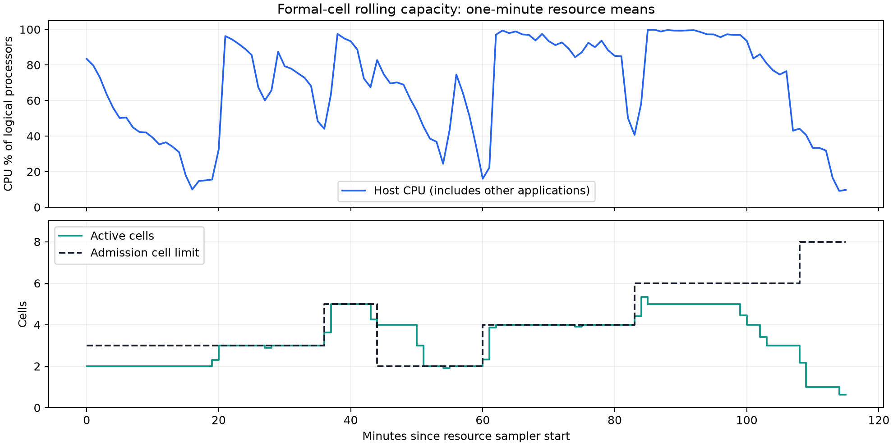
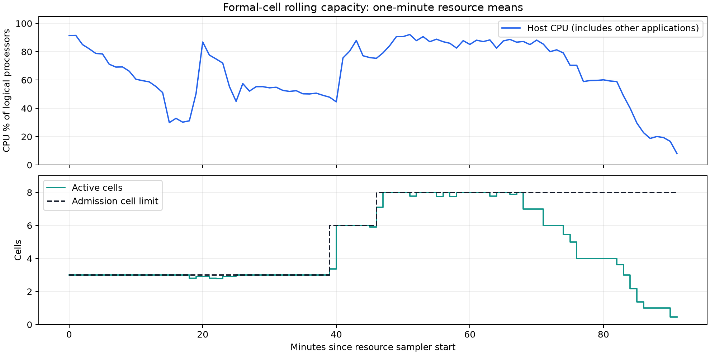

# P/B 独立预算与吞吐验证

本记录保存 2026-09-08 的框架验收和固定输入速度对照。它不提供新的 surrogate 算法优劣结论。版本为 yadof 0.6.0 与独立 yadof-benchmark 0.6.0；均从 wheel 安装到工作区环境后验收，未使用 editable install 或源码路径注入。

## P、B、I 与真实记录

- `population`（P）是进化算法保留的种群大小。
- `batch_size`（B）是后续每批新执行的正式真实评估数。
- `initial_population_size`（I；benchmark 使用 `initial_population`）是初始真实评估数。
- B、I 未设置时分别回退到 P，保持原来 P=B=I 的调用方式。G 批的完整预算为 `I + (G - 1) * B`。

`recorded_data` 与 `view-cost` 按真实评估尝试记账。某个已评估个体在多代种群中存活，只复用已有结果，不增加真实记录，也不重复增加 view-cost/HV 的正式评估横轴。例如 I=200、P=200、B=20，执行三批后是 240 条正式记录；每代的 200 个存活个体不是 200 次新仿真。失败的真实尝试仍有独立记录并计入预算，其 cost payload 可以为 `None`。

这不是按参数值对全部实验做全局去重：用户明确重新执行的一次真实评估仍是一次新尝试。Perfect surrogate 的查询有单独的 oracle 计数，不写入正式真实记录；候选被选中后执行的正式仿真才进入正式预算。

GA/NSGA-III、GPSAF 和 posterior 分支已使用独立的保留量与评估量。长历史回放由显式 program 控制终止，避免 pymoo 默认终止条件截断 B 较小时的回放。初始 I>P 的历史先按 P 做生存选择，后续回放不会让已淘汰的初始个体重新进入种群。

验证覆盖 9 组 P/B 的 GPSAF 组合、三组公开 API 的 P/B/I 关系、真实存活成员、记录 ID 唯一性、view-cost 行数与 HV 评估边界，以及 GA/NSGA-III 的 1100 代历史回放。测试见 [P/B 集成测试](../../tests/test_independent_population_batch.py)。

## 完整 benchmark 的容量对照

三个 baseline、种子 901/902、普通 NSGA-III 与 perfect GPSAF 两种策略，共 12 个单元。P=B=I=200，每单元正式预算上限 1000；普通参考跑满，perfect 在首次严格超过对应参考时停止。每个配置实际均有 9400 次正式尝试。三个配置先后独立运行，保留正常的 view-cost、baseline 可视化、收集与 workflow 后处理。

| 并行单元数 | 每单元仿真进程 | 全流程秒数 | 相对串行吞吐 | 平均采样 CPU 核数 | 峰值进程树 RSS 合计 GiB |
|---:|---:|---:|---:|---:|---:|
| 1 | 8 | 1194.986 | 1.000× | 2.71 | 2.36 |
| 4 | 2 | 754.198 | 1.584× | 4.53 | 1.93 |
| 4 | 4 | 591.115 | 2.022× | 7.09 | 3.33 |

主机有 8 个物理核、16 个逻辑核。内存值是采样的进程 RSS 求和，共享页可能重复计入；CPU 为采样区间的核数等效值。全流程时间来自 benchmark 的实际开始和结束时间，未把 observer 的启动/收尾时间计入。

三次均为 completed，12/12 单元有效，原始前台进程和资源 observer 均以 0 退出。独立核验比较了全部正式 normalized design、有限 cost 与失败位置的哈希、每批累计 top-10 轨迹、完整初始设计、首次严格达标位置、oracle 查询次数及已选候选的位级一致性，全部相同。各运行的源码/资源差异仅为执行容量；安装指纹相同。

这是每种容量各一次的描述性对照，不能推断所有机器和所有训练器都提升 2.02 倍。四路各两进程的 Chrono 收尾较长；在这组输入上提高到每单元四进程改善了收尾。CPU/GPU 总占用不高也可能来自单核计算、串行依赖、训练/选择阶段或发布开销，不能仅以某个总资源百分比是否达到 100% 判定是否还能提速。

证据位于外层工作区 `temp/pb-infrastructure-20260908/`：

- [四路各两进程的完整比对](../../../temp/pb-infrastructure-20260908/speed-4cells-2workers.json)
- [四路各四进程的完整比对](../../../temp/pb-infrastructure-20260908/speed-4cells-4workers.json)
- 原始运行：`20260908_212144-speed-serial`、`20260908_212145-speed-parallel`、`20260908_221743-speed-parallel-four-workers`；各含 `runtime_lock.json`、保存的 wheel/源码补丁、`verification/summary.json`、原始输出与资源采样。

## 固定真实数据的 GP 字段并行

`amplitude_gp(field_workers=...)` 可对独立 response 字段并行拟合。默认仍为 1；每个字段拥有自己的可写训练缓冲区，共享输入只读，结果按字段原序组装。外层统一限制原生数值线程，取消或异常时先取消并等待全部线程结束。字段并发数是执行容量，未加入模型语义参数；程序源码和冻结输入的改动检测仍然有效。

测量使用已有真实历史，不追加仿真；全部输入行参与 shape codec，GP 仍按原来的默认规则选最多 512 行拟合。每种配置输出完整的 64 个查询结果并比较哈希。串行在并行测量前后各运行一次，以下串行秒数为两次的中位数。所有这些查询输出与改动前安装包完全一致。

| 数据 | 输入真实历史行数 | 字段并发 | 串行秒数 | 并行秒数 | 拟合阶段提速 |
|---|---:|---:|---:|---:|---:|
| Synthetic antenna | 5400 | 4 | 205.160 | 113.967 | 1.800× |
| Chrono trebuchet | 2000 | 4 | 129.389 | 72.881 | 1.775× |
| SAW ladder | 5400 | 2 | 21.865 | 16.571 | 1.319× |

天线测试的峰值 RSS 从串行约 5.58–5.64 GiB 增至四字段并行约 8.35 GiB，属于用内存换吞吐。不要同时无约束地放大 cell、仿真进程和字段线程。原始测量为同目录的 `gp-parallel-testcom.json`、`gp-parallel-chrono.json`、`gp-parallel-saw.json`，保留训练行 ID、输出哈希、CPU 时间和峰值内存。

## 精确 HV 选择与简单执行方法

greedy-HV 对已知不可能增加 HV 的候选跳过重复后端计算，包括参考点范围外和已被集合支配的候选。保留原来的容差、平局顺序及 fallback。固定 1080 候选、180 次选择、4 目标，五次交错运行的中位数如下；完整选择下标和诊断完全一致。

| 情况 | 原耗时 ms | 新耗时 ms | 选择器提速 |
|---|---:|---:|---:|
| 空历史 | 16.058 | 9.714 | 1.653× |
| 混合晚期历史 | 16.670 | 5.152 | 3.236× |
| 全部被支配的晚期历史 | 9.251 | 2.129 | 4.346× |

这是毫秒级选择器微测量，不能当作整个 benchmark 的提速。证据为 [hv-shortcuts.json](../../../temp/pb-infrastructure-20260908/hv-shortcuts.json)。

benchmark 的 top-10 配对比较现在支持并行调度：只等待同 baseline/种子的 reference 发布，独立单元可并行；reference 无效时不启动其依赖候选。用户只需设置 `benchmark.configure(cell_concurrency=...)` 并调整复制 baseline 的 `physical_core_multiplier`。保留 resident fast adapter，不要求策略实现自建进程池。

大矩阵可以按种子划分为少量完整工作区，保留每个种子的所有策略及参考，逐工作区运行，再合并逐种子的原始 crossing。原因是每收集一个单元会重写累计逐点报告；已有六单元 H26 的 `results.json` 在 26000 次尝试下为 82,613,054 字节。分块减少最大报告大小与重复发布工作，但不改变实验种子、预算或统计样本。不能合并工作区中位数来代替总体中位数。简单用法见 [benchmark 执行说明](../../yadof-benchmark/user_doc/execution.md)。

## 大矩阵暴露的 Windows 状态发布问题

随后对 90 单元同矩阵进行一代结构验收时，Windows 原子替换 `state.json` 返回 `WinError 5`。该错误使控制器取消其余三个后处理进程，产生几乎同时的 exit 15；这些是取消后的次生错误。控制器实际 exit 1，而最后的状态文件仍为 `running`。原工作区有 48 个 collected、3 个 failed、1 个 checked、38 个 planned，全部原样保留，不作为算法性能样本。环境升级前已核验原 runtime lock，并保存了[失败边界](../../../temp/pb-infrastructure-20260908/20260908_220850-perfect-study/20260908_220850-formal-block-1-smoke/provenance/storage-failure-boundary.json)。

修复在遇到 Windows access/sharing/lock 冲突时进行最多两秒的有界重试，保留旧完整文件直到替换成功；不删除目标文件，不改变 ACL。其他 I/O 错误立即传播，持续占用仍会失败。致命调度错误会取消并等待活动命令退出，写入 `execution_error` 和终态，将已经开始但未正常结束的单元标记为 failed；`inspect` 优先显示主因。如果存储持续不可写，调用者仍收到包含原始错误和终态写入错误的信息。

回归包含真实 Windows 文件句柄禁止 delete sharing 的场景、短暂/永久占用、非共享类 I/O 故障，以及两个并行命令取消后不得继续启动第三个单元。修复后的新工作区与此前注册的八个正式/结构输入逐一做了完整输入指纹比较，均相同；仅更换包含存储修复的安装包，没有改变种子、策略、预算或组合。前述容量对照的数据使用各自保存的修复前 wheel，未重标为修复后的新计时。

## 安装与回归验收

### 2026-09-09 Chrono 启动目录边界

提交内存保护后的滚动正式运行又暴露了独立的 `WinError 267`，来源是 Windows `CreateProcess` 的工作目录长度边界。轻量子进程探针未导入仿真器；分别用工作区 Python 和配置的外部 Python 启动 `print`，248、256、257、258 个字符的目录均成功，259、260、261、280 均在启动前失败。证据为外层 `temp/launch-directory-probe/results.json`。

该正式工作区中，worker 0–9 的 Chrono session 路径为 258 个 UTF-16 单元，worker 10 及以上为 259。原适配器把 259 也当成安全路径，因而只让部分工作进程启动失败；普通 reference 可以继续完成，但这样的基础设施失败不能作为物理不可行设计计入算法比较。全部 Chrono case/seed 组已由修复后的完整配对组替换，保留原证据；同工作区 SAW 的两个完整组经独立审计后保留。

源码修复将启动上限设为 258，并按 UTF-16 单元计数；更长的 resident 路径沿用短目录启动、协议传递正式 scratch 的现有机制。框架资源与 benchmark 随包 Chrono 副本同步。边界回归覆盖 258、259、300 单元以及包含非 BMP 字符的路径。benchmark 收集阶段也拒绝明确标记 `physical_failure=False` 的任务/基础设施失败，避免有限结果掩盖受污染的 reference。安装后的 resident/subprocess 专测 23 passed、7.40 秒；完整 yadof 574 passed、156.99 秒，两个预期 GP 收敛警告；benchmark 当时 95 passed、24.90 秒。两个已安装 Chrono 适配器副本逐字节一致。修复后的 20 个正式 Chrono cell 及两个完整种子组的独立审计均成功，原前台进程与审计进程均 exit 0。

### 2026-09-09 提交内存故障与修复

首次 40-cell 滚动正式运行在四个参考完成后发生 Windows 提交内存耗尽。系统事件 2004 在 02:50:05、02:51:29、02:52:37 UTC 记录约 175.57 GB 已提交、约 175.60 GB 上限，而物理内存仅用约 22.7 GB；多个 Python 子进程各有约 2.08 GB 提交量。用户同时报告 ngspice 错误窗口和远程桌面失联。控制器原 session 6793 实际 exit 1，留下 4 collected、8 failed、28 planned；无完整 case/seed 组，因此不进入科学中位数。安装升级前已经核验其 runtime lock，原始状态、事件和失败边界保存在 `20260909-five-seed-revision/20260909_101530-formal-adaptive-40/provenance/`。

当时的资源观察仅检查可用物理内存，遗漏 Windows commit；实际 benchmark 子进程启动器也没有落实文档中声称已有的数值库线程限制。Perfect 的正式和 oracle 两个常驻池会同时保留进程，即使只有一个阶段在计算，也消耗提交额度。性能工作流对失败 cell 的继续策略又在资源耗尽后启动了新 cell。

修复在每次 Popen 前用私有环境副本把 BLAS/OpenMP、BLIS、Accelerate、NumExpr 的线程数设为 1，后代在导入数值库前继承；不修改调用者或系统环境。三次交错的冷进程导入 NumPy、SciPy、threadpoolctl 和 fast runner，提交内存中位数从 1,050,599,424 降到 39,292,928 字节（减少 96.26%），RSS 中位数从 61,415,424 到 59,105,280 字节。该数字只描述这组导入，不是整个 benchmark 的内存降幅，也没有反推每个故障 PID 的准确环境。证据为该失败工作区 `provenance/commit-import-probes.json`，没有运行仿真。

通用 benchmark 执行器新增 Windows 子进程树提交总上限、独立的 0.25 秒全局提交余量检查与物理内存余量检查。内存异常始终停止新 cell 并取消活动命令，不受 `fail_fast=False` 影响；正常物理失败仍按原协议记账。当前 job 上限不超过起始 commit limit 的 60%，并为其他应用保留至少 20%（最少 2 GiB）全局 commit 余量；具体计算与证据字段见 benchmark 执行说明。未修改系统页面文件。

安装包完整回归 94 passed，24.38 秒。随后加强了多个并行根进程共享同一 Windows job 的测试，重建并安装相同实现，内存保护专测 5 passed，0.82 秒。受控测试在 128 MiB job 配额下拒绝孙进程的 256 MiB 提交请求，没有耗尽主机。后续正式运行根据各 baseline 的实测私有提交峰值限制新 cell 并发；这不是单凭 CPU 百分比无限增加进程。

### 正式 cell 内的分批容量校准与最终默认值

使用剩余的 20 个 SAW 与 20 个 Chrono 正式单元做滚动校准，没有另加独立速度实验。SAW 尝试物理核倍率 0.5、1、2；Chrono 尝试 1、2、4。每批完成少量候选后调整随后准入的容量，正在运行的 cell 保持原配置。正式种子、P/B/I、算法与停止规则不变。Chrono 的路径故障组整体替换后再测，失败尝试原样保留。

| Baseline | 物理核倍率 | 完成的 perfect cell 数 | 单 cell 查询/秒中位数 | 估算 baseline 查询/秒中位数 |
|---|---:|---:|---:|---:|
| Chrono | 1 | 13 | 10.137 | 43.617 |
| Chrono | 2 | 4 | 11.840 | 38.024 |
| Chrono | 4 | 1 | 21.275 | 42.549 |
| SAW | 0.5 | 7 | 11.189 | 71.594 |
| SAW | 1 | 4 | 16.782 | 67.980 |
| SAW | 2 | 7 | 13.887 | 102.124 |

每项查询包括正式仿真和 oracle 仿真。估算 baseline 速率是单 cell 速率乘以该 cell 运行期间同 baseline 的平均活动 cell 数，不是独立测得的总吞吐。P/B、种子、停止长度和同时活动的工作不同，因此这些是描述性选型证据，不能把比值解释成严格因果提速。Chrono 四倍只有一个已完成候选，证据尤其有限；其高提交估算把同时准入量限制到 2，之后选择一倍并恢复更多 cell。没有宣称找到所有机器上的最优倍率。

最终通用默认是 **4 个 cell**，Chrono **1 倍物理核数/cell**、SAW **2 倍**、天线 **1 倍**。在 8 物理核/16 逻辑核主机上，四个相同 baseline 的就绪 cell 分别形成 32、64、32 路仿真容量；数值库内部线程仍为 1。这两个配置都是通用 benchmark 参数，不局限于 perfect。任务局部的滚动决策脚本只用于这次校准，用户文档只要求配置这两个已有参数。

Chrono 的四 cell/一倍阶段（准入版本 5、6，共 202 个采样点）主机 CPU 平均 **84.96%**、中位数 **93.1%**；五到六个活动 cell 的后续阶段平均约 97.86%。SAW 八个活动 cell 的充分展开阶段在约 85–90%。初始化只剩配对参考可运行、批次切换和末尾剩余 cell 减少时占用会下降，不能保证全过程持续 100%。主机 CPU 包含其他应用；进程树 CPU 估算漏掉短 ngspice 子进程，且采样时间窗不完全对齐，个别估算会超过 100%，因此这里的占用结论与图只使用主机 CPU。

Chrono 修复后 20-cell 工作区全流程 **6933.698 秒**，进程树私有提交峰值 **11.354 GiB**，全局提交余量最小 **34.706 GiB**。SAW 所在工作区私有提交峰值 **6.881 GiB**、提交余量最小 **38.523 GiB**；其全流程 5508.642 秒还包含被排除的 Chrono 路径故障阶段，不能把它当成 SAW 独立耗时。两个运行都没有提交内存保护或 sampler 故障，SAW 的完整两组与 Chrono 修复后的完整两组都通过独立审计。

完整容量表与采样索引在外层 `temp/pb-infrastructure-20260908/20260909-five-seed-revision/chrono-capacity-report-reviewed/` 和 `saw-capacity-report-reviewed/`。包含失败阶段的原工作区状态未改写。全部 150 个正式单元合并后的五种子中位数、删失结果与逐种子数据见[新的 P/B perfect 基准](20260909_152719_five-seed-perfect-surrogate-pb-baseline.md)。

- yadof 完整安装包测试：571 passed，116.74 秒；两个预期的 GP 收敛警告。
- yadof-benchmark 容量对照前完整安装包测试：72 passed，22.66 秒；Windows 存储修复后：80 passed，21.55 秒。
- 完整 preset 的一代结构验收：18/18 有效，607.136 秒，九组完整初始设计配对通过独立核验。该结果仅证明工作流完整性，不作为算法性能证据。
- 存储修复后首批同矩阵一代结构验收：90/90 有效，1198.264 秒；独立核验九个 case/seed 组的全部 P/B 初始设计、唯一正式记录、cost 轨迹与必需输出。共 18000 次真实尝试，其中 16430 次有限、1570 次失败/非有限，全部保留计数。控制器、observer、独立核验均 exit 0。证据在 `20260908_231745-perfect-study/20260908_231745-formal-block-1-smoke/verification/summary.json`；一代结构结果不进入正式中位数。
- 两包 import origin 均位于工作区 `.venv/Lib/site-packages`。实验与独立核验期间保持安装包和 runtime lock 冻结。
- 最终四 cell 默认及 Chrono/SAW 不同倍率已经构建、force-reinstall 并通过 benchmark 完整安装包回归：95 passed，23.94 秒。此后的 yadof 修改仅为 context/userdoc 内容，按文档维护例外刷新 wheel 以便 `yadof docs` 立即可见，不为纯文字重复软件测试；保留最新 574 项核心回归结果。

源码基点为 `6c95eb2a5cddc5eff3e03727c6566bf20c401ba6` 加运行保存的任务补丁；较早的完整 preset smoke 保留其实际的 `b392949...` 基点和对应补丁。另一个研究任务的 preparation 并发修复已进入 `6c95eb2`，本次保留并覆盖了安装回归。吞吐数据不包含 H26 的任务局部 inverse-cache 技术，也没有声称测得 H26 全程的同等加速。
