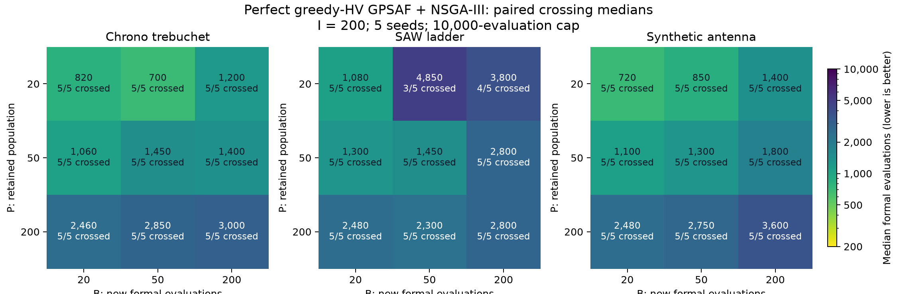

# 五种子 perfect greedy-HV GPSAF + NSGA-III 的 P/B 基准

本轮以三项 baseline、P/B 各取 20、50、200 的全部九种组合、五个种子
1101–1105 建立后续算法研究的经验基准。135 个 perfect 单元与 15 个普通参考，
共 150 个正式单元已独立核验；中位数按每组全部五次实验计算。旧的单种子
perfect 数字和研究门槛已移出活跃 context，不再用作当前比较基准。

## 统一实验协议

P 是保留种群，B 是后续每批新执行的正式评估数，I 固定为 200。所有组合使用
相同种子的同一初始设计，包括 P<B、P>B 和 I>P。正式尝试上限均为 10,000；
B=20/50/200 分别最多 491/197/50 批。GPSAF 使用 α=3、β=3、γ=0.5、
探索比例 0.1 和 greedy-HV 选择；普通参考为同 baseline/种子的
NSGA-III P200/B200/I200/G50。

每个真实候选的分数为各 objective cost 的算术平均，以 `math.fsum` 计算；
Q 为累计正式历史中十个最低有限分数的平均值。主指标 N 是第一次在完整正式批次
末尾严格满足 Q<R 的累计正式尝试数，R 是该种子普通参考跑满 10,000 次的最终 Q。
失败和非有限尝试仍计入 N。到上限未严格超过的实验保留为右删失的 >10,000，
不以成功子集计算中位数；基础设施无效组单独排除并完整替换。

分位数采用经验分布最近秩：五次排序中的第二、第三、第四个值分别为 Q25、中位数、
Q75。若相应秩落在删失实验，报告 >10,000，不能把它当成精确的 10,000。

## 正式评估次数基准

| Baseline | P | B | Crossings / 5 | Q25 | Median formal evaluations | Q75 |
|---|---:|---:|---:|---:|---:|---:|
| chrono/trebuchet | 20 | 20 | 5 | 780 | 820 | 960 |
| chrono/trebuchet | 20 | 50 | 5 | 650 | 700 | 800 |
| chrono/trebuchet | 20 | 200 | 5 | 1,200 | 1,200 | 1,400 |
| chrono/trebuchet | 50 | 20 | 5 | 860 | 1,060 | 1,700 |
| chrono/trebuchet | 50 | 50 | 5 | 1,250 | 1,450 | 2,250 |
| chrono/trebuchet | 50 | 200 | 5 | 1,200 | 1,400 | 1,600 |
| chrono/trebuchet | 200 | 20 | 5 | 2,320 | 2,460 | 3,180 |
| chrono/trebuchet | 200 | 50 | 5 | 2,150 | 2,850 | 3,000 |
| chrono/trebuchet | 200 | 200 | 5 | 2,800 | 3,000 | 4,000 |
| ngspice/saw-ladder | 20 | 20 | 5 | 780 | 1,080 | 1,600 |
| ngspice/saw-ladder | 20 | 50 | 3 | 1,100 | 4,850 | >10,000 |
| ngspice/saw-ladder | 20 | 200 | 4 | 3,000 | 3,800 | 5,000 |
| ngspice/saw-ladder | 50 | 20 | 5 | 1,300 | 1,300 | 1,560 |
| ngspice/saw-ladder | 50 | 50 | 5 | 1,050 | 1,450 | 1,950 |
| ngspice/saw-ladder | 50 | 200 | 5 | 1,800 | 2,800 | 3,000 |
| ngspice/saw-ladder | 200 | 20 | 5 | 2,320 | 2,480 | 2,520 |
| ngspice/saw-ladder | 200 | 50 | 5 | 2,150 | 2,300 | 5,650 |
| ngspice/saw-ladder | 200 | 200 | 5 | 2,400 | 2,800 | 3,600 |
| test-com/synthetic-antenna | 20 | 20 | 5 | 640 | 720 | 740 |
| test-com/synthetic-antenna | 20 | 50 | 5 | 850 | 850 | 900 |
| test-com/synthetic-antenna | 20 | 200 | 5 | 1,400 | 1,400 | 1,600 |
| test-com/synthetic-antenna | 50 | 20 | 5 | 1,080 | 1,100 | 1,120 |
| test-com/synthetic-antenna | 50 | 50 | 5 | 1,150 | 1,300 | 1,450 |
| test-com/synthetic-antenna | 50 | 200 | 5 | 1,800 | 1,800 | 1,800 |
| test-com/synthetic-antenna | 200 | 20 | 5 | 2,320 | 2,480 | 2,520 |
| test-com/synthetic-antenna | 200 | 50 | 5 | 2,650 | 2,750 | 2,800 |
| test-com/synthetic-antenna | 200 | 200 | 5 | 3,400 | 3,600 | 4,200 |

每格均有五次实验；Crossings 表示五次中实际达标的次数。当前研究应匹配 P、B、I、
正式预算、成本定义和对应参考，再比较重复实验分布。不能把某个最小中位数直接
移作所有组合的门槛，也不能只挑选较容易超过的普通参考。

## 配对普通参考

以下保存逐种子的 R，科学统计使用这些未舍入的原始值；表格只做显示舍入。
精确值及 27 组逐种子 N 保存在[配套数据](20260909_152719_five-seed-perfect-surrogate-pb-baseline_data.json)。

| 普通参考 R | 1101 | 1102 | 1103 | 1104 | 1105 |
|---|---:|---:|---:|---:|---:|
| chrono/trebuchet | 0.193580467765 | 0.184897376054 | 0.156311162248 | 0.170205736109 | 0.182033613239 |
| ngspice/saw-ladder | 0.227368989422 | 0.27252182402 | 0.246038080121 | 0.194620200089 | 0.245712878315 |
| test-com/synthetic-antenna | 0.2908259761 | 0.290419939054 | 0.29299147581 | 0.294061512829 | 0.291992535452 |

## 记录与核验

全部正式实验共 455,740 次真实尝试，
其中 449,647 次有限结果、
6,093 次失败或非有限结果。
Perfect 另外执行 1,505,196 次 oracle 仿真查询，单独记账，
不写入正式 recorded_data 或 view-cost 的正式评估横轴。已评估个体跨代存活只复用
已有结果，不重复记录；这里没有按参数值合并用户主动重新执行的真实尝试。

独立审计从正式记录重新计算逐批 Q、首次严格达标位置、预算、唯一记录 ID、完整初始
设计、正式 design/cost 指纹和必需输出，并检查已选 oracle 预测与正式结果的位级一致性。
所有候选与同种子普通参考的初始设计相同。核验在各自冻结的安装与输入下完成；
保留的旧 110 个单元另做只读失败元数据核查，未发现非物理基础设施失败。

最终样本来自四组完整的 case/seed 证据：最初三种子 90 个单元、第四/第五种子的
20 个 test-com 单元、提交保护后两个完整 SAW 组的 20 个单元，以及修复 Windows
启动目录边界后重跑的两个完整 Chrono 组的 20 个单元。旧的 11 种子计划已在分析前
缩为五种子。提交内存耗尽的运行没有完整组，不纳入；路径边界故障运行的全部 Chrono
单元（包括貌似完成的参考）被排除，保留原始证据。组的保留与替换依据基础设施有效性，
不是优化结果优劣。中断工作区中保留的部分只在完整配对组通过审计后合并，不把工作区
的 failed/interrupted 状态改写成 completed。

保留的 test-com 工作区在中断前已收集完整单元，但尚未执行最终 perfect-summary
后处理。总体汇总读取其原始逐 cell result 与独立审计结果，并重新核对收集有效性；
没有向旧工作区补写一个貌似当时已经完成的全工作区报告。

四组运行都记录实际源码 HEAD、补丁、输入和 wheel 指纹。运行期间的基础设施修复使
wheel 指纹不同，不能声称它们使用同一个安装镜像；每组参考与候选均遵循同一科学协议。
容量调整仅作用于随后启动的正式 cell，不改种子、算法、物理模型、P/B/I 或停止规则。
并发与提交内存结果见 [P/B 与吞吐验收](20260908_224400_population-batch-and-throughput-validation.md)。

## 使用边界

Perfect 的含义是对已查询候选池提供准确预测。它是当前搜索/选择流程的经验对照，
不是对全局最优搜索的数学证明：greedy-HV 优化的多目标覆盖与最终 scalar top-10 指标
不同，候选选择又会改变后续搜索轨迹。实际 surrogate 在少数种子或个别指标上超过
perfect 不能单独证明测试有错，也不能据此宣布算法更优。五次中位数减少了单次偶然性，
仍不是严格上界或独立算法接受标准；新算法应做同协议的配对重复比较。

完整审计、未舍入结果及原始运行索引见外层工作区
[`temp/pb-infrastructure-20260908/20260909-five-seed-revision/five-seed-final-results/summary.json`](../../../temp/pb-infrastructure-20260908/20260909-five-seed-revision/five-seed-final-results/summary.json) 和
[`audited-cells.json`](../../../temp/pb-infrastructure-20260908/20260909-five-seed-revision/five-seed-final-results/audited-cells.json)。
本文件与配套数据保留足够的逐种子基准供后续任务读取；大型 rawData 不进入 Git。
