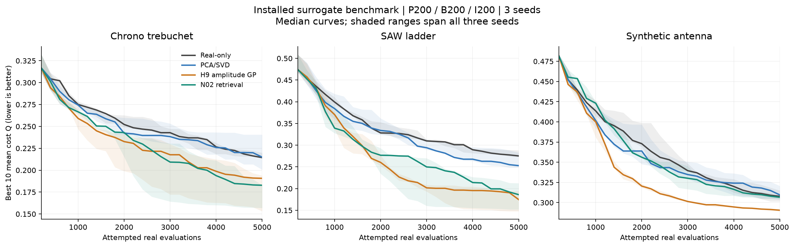

# 已安装 surrogate 完整 benchmark 收尾

完成时间：2026-09-11 00:10:35（北京时间），对应 UTC 2026-09-10 16:10:35。
完整矩阵 **36/36 单元有效**，共 **180000 次真实尝试、177097 次有限结果、2903 次失败或非有限结果**。
所有保留单元均完成 5000 次预算，失败仍计入横轴。没有通过修改失败状态或降低预算来完成矩阵。

## 协议与证据边界

三个打包基准、四策略、种子 101/102/103，P200/B200/I200/G25；两单元并发，单元超时 7200 秒。
GPSAF α=3、β=3、γ=0.5、探索比例0.1，greedy-HV；底层 NSGA-III 操作器一致。
PCA/SVD 沿用既有重叠训练程序；H9/N02 采用本次明确提供的选择前全历史训练程序。
这是完整程序之间的描述性回归比较，不能把差异全部归因于模型架构。
这些种子和 P200 协议不构成历史 P50/perfect 目标的全新确认。

Q 是累计真实历史中十个最低有限“各目标成本算术平均值”的平均，越低越好。
N 是某策略首次在完整批次末尾严格低于同基准同种子普通策略5000次最终Q的真实尝试数。
未跨过者保留为 >5000，计算中位数时保留删失；不以成功子集替代。
这里没有使用 perfect oracle，也不能把此N与旧研究的perfect比值直接拼接。

## 结果

最终 Q 的三个种子中位数：

| 基准 | 普通 | PCA/SVD | H9 | N02 |
|---|---:|---:|---:|---:|
| Chrono | 0.214376 | 0.214922 | 0.190732 | 0.182822 |
| SAW | 0.275309 | 0.252925 | 0.174787 | 0.186106 |
| 天线 | 0.307846 | 0.309583 | 0.290596 | 0.306597 |

图中曲线为三个种子中位数，阴影覆盖三个种子的最小到最大值；不是置信区间。

| 基准 | 策略 | 配对 Q 比值中位数 | 胜普通种子数 / 3 | N 中位数 | 优化耗时中位数（分） |
|---|---|---:|---:|---:|---:|
| Chrono | 普通 NSGA-III | 1.000000 | — | — | 5.96 |
| Chrono | PCA/SVD | 1.004644 | 1 | >5000 | 16.50 |
| Chrono | H9 幅值/形状 GP | 0.867364 | 3 | 3000 | 52.86 |
| Chrono | N02 邻居响应修正 | 0.831392 | 3 | 3000 | 13.57 |
| SAW | 普通 NSGA-III | 1.000000 | — | — | 4.03 |
| SAW | PCA/SVD | 0.927807 | 2 | 3600 | 8.37 |
| SAW | H9 幅值/形状 GP | 0.606361 | 3 | 1800 | 13.67 |
| SAW | N02 邻居响应修正 | 0.675989 | 3 | 1800 | 7.42 |
| 天线 | 普通 NSGA-III | 1.000000 | — | — | 5.14 |
| 天线 | PCA/SVD | 0.985426 | 2 | 4800 | 24.97 |
| 天线 | H9 幅值/形状 GP | 0.943964 | 3 | 2800 | 94.19 |
| 天线 | N02 邻居响应修正 | 0.999759 | 2 | 5000 | 26.11 |

配对Q比值先在同种子内计算再取中位数，不等于两列Q中位数相除。
耗时为已记录优化命令墙钟时间，包含模型、优化和仿真；不包含后续可视化发布。
本机廉价基准中，所有surrogate程序都比普通策略更慢；减少真实尝试不等于这里的总耗时降低。

H9 在本矩阵9/9种子最终Q优于普通策略，SAW和天线的Q中位数最低，但计算开销明显较高。
N02 在Chrono和SAW各3/3种子优于普通策略，Chrono的Q中位数最低；天线仅2/3，配对比值
中位数约0.999759，基本没有Q收益。N02相对H9的优化耗时中位数更短，但仍不是通用赢家。
保留两者为选配组件，N02继续明确标为实验组件；不更改默认surrogate。

## 中断、补跑与完整性

原36单元运行在UTC 10:56附近遭遇原因未确定的进程退出，最后日志为10:56:42。
主机未重启；之后核对日志中的精确进程ID及Python命令行，确认原执行进程已不在。
原state.json仍残留running，原文件保持原样，不能称该工作区完整成功。

保留原执行中已经完整收集的Chrono全部12单元。原SAW的3个已收集参考及2个部分执行单元
不进入最终矩阵；在全新工作区重跑SAW和天线的完整24单元。选择依据是完整基准组与基础设施
完整性，未参考优化质量挑选种子。补跑工作区正常completed，24/24有效。

两批保留结果的基准源码摘要、策略摘要、预算、种子、执行策略和安装包版本逐项相同。
每个基准/种子的四策略初始200个设计指纹完全一致；36种语义组合无遗漏、无重复。
全部目标/rawData合同匹配、逐单元必需图像和domain输出存在；H9/N02的18个单元合计432次
训练全部完成，无训练失败。Q和逐批N由收集结果的逐记录目标值重新计算，并核对有限数、
唯一job标识和完整预算。这是结果层核验，没有宣称重新执行全部仿真或重算全部rawData。

先后完成未改策略的36单元烟雾验证和剩余24单元烟雾验证，分别7200和4800次尝试。
烟雾数据及原SAW被替换的部分均不并入正式统计；保留原始证据。

## 软件与监控验收

两个0.6.0 wheel均从源码成功构建、强制安装，导入来自指定环境site-packages。
yadof全量 **593 passed**（118.03秒；2条已有GP核边界收敛提示）；benchmark全量
**97 passed**（23.81秒）。最终文档刷新另行执行安装文档与CLI检查。
N02默认200步训练与研究原型比较：保留潜变量及1/127/128/129查询的全部响应字段逐值一致。
H9/N02公开程序各完成两个真实执行代、128次尝试，确认第二代实际使用surrogate。
23个原context文件经HEAD对照确认正文、数据保持，只有位置与相对链接变化。

监控均委派给 `gpt-5.6-luna`、low、`fork_turns="none"`。第一代理曾提前结束回合，后台采样
继续但即时代理通知不可保证；后续监控进程也随外部中断消失，这些限制没有隐去。
补跑代理持续到终态，61个快照、间隔中位数300.322秒、最大300.561秒；正常退出。
主代理使用长等待、每小时请求或读取代理已保存的简短快照。进程丢失时才额外诊断，未重复启动
正在运行的benchmark。指南已补充yield不等于进程退出、后台存活不等于代理持续等待等规则。

完整精度、逐批Q及来源SHA256见[数据](20260911_001924_installed-surrogate-benchmark-data.json)；测试、数值一致性和监控间隔见
[验收证据](20260911_001924_delivery-verification.json)。逐单元原生结果如下（source workspace区分重复cell编号）：

| 基准 | 策略 | 种子 | 最终 Q | 有限 / 尝试 | N | 来源单元 |
|---|---|---:|---:|---:|---:|---|
| Chrono | 普通 NSGA-III | 101 | 0.214375772 | 4719/5000 | — | [c0001](../../../../temp/20260910_155836-surrogate-delivery-complete-20260910/cells/c0001/result.json) |
| Chrono | 普通 NSGA-III | 102 | 0.219898678 | 4610/5000 | — | [c0002](../../../../temp/20260910_155836-surrogate-delivery-complete-20260910/cells/c0002/result.json) |
| Chrono | 普通 NSGA-III | 103 | 0.213928985 | 4692/5000 | — | [c0003](../../../../temp/20260910_155836-surrogate-delivery-complete-20260910/cells/c0003/result.json) |
| Chrono | PCA/SVD | 101 | 0.240679147 | 4836/5000 | >5000 | [c0004](../../../../temp/20260910_155836-surrogate-delivery-complete-20260910/cells/c0004/result.json) |
| Chrono | PCA/SVD | 102 | 0.200538228 | 4764/5000 | 3800 | [c0005](../../../../temp/20260910_155836-surrogate-delivery-complete-20260910/cells/c0005/result.json) |
| Chrono | PCA/SVD | 103 | 0.214922469 | 4790/5000 | >5000 | [c0006](../../../../temp/20260910_155836-surrogate-delivery-complete-20260910/cells/c0006/result.json) |
| Chrono | H9 幅值/形状 GP | 101 | 0.153067998 | 4848/5000 | 1800 | [c0007](../../../../temp/20260910_155836-surrogate-delivery-complete-20260910/cells/c0007/result.json) |
| Chrono | H9 幅值/形状 GP | 102 | 0.190732105 | 4854/5000 | 3000 | [c0008](../../../../temp/20260910_155836-surrogate-delivery-complete-20260910/cells/c0008/result.json) |
| Chrono | H9 幅值/形状 GP | 103 | 0.193967624 | 4852/5000 | 4000 | [c0009](../../../../temp/20260910_155836-surrogate-delivery-complete-20260910/cells/c0009/result.json) |
| Chrono | N02 邻居响应修正 | 101 | 0.183179323 | 4657/5000 | 3000 | [c0010](../../../../temp/20260910_155836-surrogate-delivery-complete-20260910/cells/c0010/result.json) |
| Chrono | N02 邻居响应修正 | 102 | 0.182822039 | 4655/5000 | 3600 | [c0011](../../../../temp/20260910_155836-surrogate-delivery-complete-20260910/cells/c0011/result.json) |
| Chrono | N02 邻居响应修正 | 103 | 0.156889312 | 4820/5000 | 2200 | [c0012](../../../../temp/20260910_155836-surrogate-delivery-complete-20260910/cells/c0012/result.json) |
| SAW | 普通 NSGA-III | 101 | 0.288255967 | 5000/5000 | — | [c0001](../../../../temp/20260910_190502-surrogate-delivery-remaining-complete-20260910/cells/c0001/result.json) |
| SAW | 普通 NSGA-III | 102 | 0.272604785 | 5000/5000 | — | [c0002](../../../../temp/20260910_190502-surrogate-delivery-remaining-complete-20260910/cells/c0002/result.json) |
| SAW | 普通 NSGA-III | 103 | 0.275308647 | 5000/5000 | — | [c0003](../../../../temp/20260910_190502-surrogate-delivery-remaining-complete-20260910/cells/c0003/result.json) |
| SAW | PCA/SVD | 101 | 0.248122623 | 5000/5000 | 3200 | [c0004](../../../../temp/20260910_190502-surrogate-delivery-remaining-complete-20260910/cells/c0004/result.json) |
| SAW | PCA/SVD | 102 | 0.252924576 | 5000/5000 | 3600 | [c0005](../../../../temp/20260910_190502-surrogate-delivery-remaining-complete-20260910/cells/c0005/result.json) |
| SAW | PCA/SVD | 103 | 0.283002718 | 5000/5000 | >5000 | [c0006](../../../../temp/20260910_190502-surrogate-delivery-remaining-complete-20260910/cells/c0006/result.json) |
| SAW | H9 幅值/形状 GP | 101 | 0.174787123 | 5000/5000 | 1400 | [c0007](../../../../temp/20260910_190502-surrogate-delivery-remaining-complete-20260910/cells/c0007/result.json) |
| SAW | H9 幅值/形状 GP | 102 | 0.147699651 | 5000/5000 | 2200 | [c0008](../../../../temp/20260910_190502-surrogate-delivery-remaining-complete-20260910/cells/c0008/result.json) |
| SAW | H9 幅值/形状 GP | 103 | 0.194210015 | 5000/5000 | 1800 | [c0009](../../../../temp/20260910_190502-surrogate-delivery-remaining-complete-20260910/cells/c0009/result.json) |
| SAW | N02 邻居响应修正 | 101 | 0.212542971 | 5000/5000 | 1800 | [c0010](../../../../temp/20260910_190502-surrogate-delivery-remaining-complete-20260910/cells/c0010/result.json) |
| SAW | N02 邻居响应修正 | 102 | 0.152109374 | 5000/5000 | 1800 | [c0011](../../../../temp/20260910_190502-surrogate-delivery-remaining-complete-20260910/cells/c0011/result.json) |
| SAW | N02 邻居响应修正 | 103 | 0.186105553 | 5000/5000 | 2800 | [c0012](../../../../temp/20260910_190502-surrogate-delivery-remaining-complete-20260910/cells/c0012/result.json) |
| 天线 | 普通 NSGA-III | 101 | 0.307846270 | 5000/5000 | — | [c0013](../../../../temp/20260910_190502-surrogate-delivery-remaining-complete-20260910/cells/c0013/result.json) |
| 天线 | 普通 NSGA-III | 102 | 0.315048045 | 5000/5000 | — | [c0014](../../../../temp/20260910_190502-surrogate-delivery-remaining-complete-20260910/cells/c0014/result.json) |
| 天线 | 普通 NSGA-III | 103 | 0.301457486 | 5000/5000 | — | [c0015](../../../../temp/20260910_190502-surrogate-delivery-remaining-complete-20260910/cells/c0015/result.json) |
| 天线 | PCA/SVD | 101 | 0.303359609 | 5000/5000 | 4200 | [c0016](../../../../temp/20260910_190502-surrogate-delivery-remaining-complete-20260910/cells/c0016/result.json) |
| 天线 | PCA/SVD | 102 | 0.309583493 | 5000/5000 | 4800 | [c0017](../../../../temp/20260910_190502-surrogate-delivery-remaining-complete-20260910/cells/c0017/result.json) |
| 天线 | PCA/SVD | 103 | 0.320732258 | 5000/5000 | >5000 | [c0018](../../../../temp/20260910_190502-surrogate-delivery-remaining-complete-20260910/cells/c0018/result.json) |
| 天线 | H9 幅值/形状 GP | 101 | 0.290595685 | 5000/5000 | 2800 | [c0019](../../../../temp/20260910_190502-surrogate-delivery-remaining-complete-20260910/cells/c0019/result.json) |
| 天线 | H9 幅值/形状 GP | 102 | 0.289219826 | 5000/5000 | 2400 | [c0020](../../../../temp/20260910_190502-surrogate-delivery-remaining-complete-20260910/cells/c0020/result.json) |
| 天线 | H9 幅值/形状 GP | 103 | 0.291006435 | 5000/5000 | 3000 | [c0021](../../../../temp/20260910_190502-surrogate-delivery-remaining-complete-20260910/cells/c0021/result.json) |
| 天线 | N02 邻居响应修正 | 101 | 0.307772045 | 5000/5000 | 5000 | [c0022](../../../../temp/20260910_190502-surrogate-delivery-remaining-complete-20260910/cells/c0022/result.json) |
| 天线 | N02 邻居响应修正 | 102 | 0.304399338 | 5000/5000 | 3200 | [c0023](../../../../temp/20260910_190502-surrogate-delivery-remaining-complete-20260910/cells/c0023/result.json) |
| 天线 | N02 邻居响应修正 | 103 | 0.306597250 | 5000/5000 | >5000 | [c0024](../../../../temp/20260910_190502-surrogate-delivery-remaining-complete-20260910/cells/c0024/result.json) |
